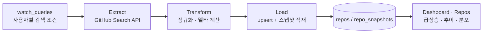
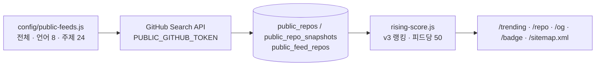
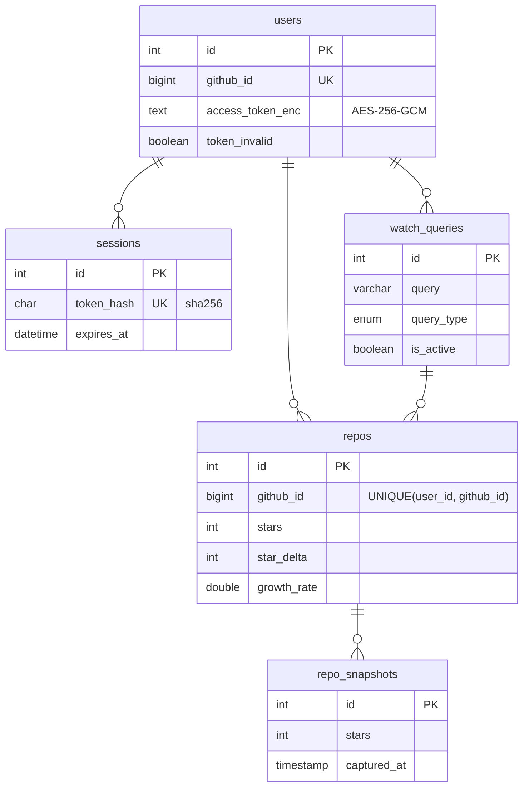

# Trendar

> **지금 뜨는 GitHub 레포를 남들보다 먼저.** — 관심 키워드의 오픈소스를 추적해 *스타 증가율(추세)* 로 급상승 레포를 골라주는 GitHub 트렌드 레이더.

**라이브 데모 → https://trendar.org** (GitHub 계정으로 로그인, 가입 불필요) · **로그인 없이 보기 → https://trendar.org/trending**

---

## 왜 만들었나

GitHub Search API는 **"현재 스타 몇 개"** 만 알려주지, **"지금 뜨고 있는지"** 는 알려주지 않는다.
그래서 정작 궁금한 *"요즘 빠르게 성장하는 레포"* 를 찾을 수가 없다.

Trendar는 관심 키워드에 매칭되는 레포의 스타 수를 **6시간마다 스냅샷으로 기록**하고,
이전 스냅샷과 비교해 **증가율(델타)** 을 계산함으로써 *"지금 뜨는 레포"* 를 보여준다.

> 비유하면 체중계 앱과 같다 — 매번 몸무게를 재서(스냅샷) 어제보다 얼마 빠졌나(델타)를 보여주듯, "레포의 스타"를 계속 재는 것.

---

## 핵심 기능

- **트렌드 추적** — 현재 스타가 아니라 *스타 증가율* 로 급상승 레포를 포착
- **신생 트렌드 발견** — 스타순 수집과 별도로 최근 90일 내 생성 레포 슬라이스를 병행 수집하고, 생성 15일 이내·최근 24시간 500스타 이상 증가한 레포를 '신생 급상승'으로 노출 — 역대 스타 상위에 가려진 진짜 뜨는 신규 프로젝트를 잡는다
- **목적형 수집** — 전체를 긁는 크롤러가 아니라, 사용자가 등록한 검색 조건(watch query)에 매칭되는 레포만 선별 수집
- **시계열 스냅샷** — 시점별 지표를 쌓아 레포별 성장 추이를 차트로 제공
- **생태계 분포** — 관심 영역이 어떤 언어·조건으로 분포하는지 집계
- **큐레이션** — 관심 레포를 북마크·메모로 추적
- **멀티테넌트** — GitHub 로그인 기반. 검색어·레포·북마크가 **사용자별로 완전 격리**되고, 수집도 **각자의 OAuth 토큰**으로 실행되어 레이트리밋을 분산
- **남용 방지** — 수동 수집에 사용자별 **일일 한도**(기본 10회, KST 자정 리셋), 조건 개수 상한
- **공개 트렌드** — 로그인 없이 볼 수 있는 서버 렌더 페이지(`/trending`, 언어·주제별 피드, 레포 페이지, 한국어 `/ko`). 서버 전용 토큰으로 모은 공개 풀을 하루 환산 증가 속도로 랭킹하고, 링크 미리보기 PNG·README 배지·동적 sitemap을 제공 ([공개 트렌드](#공개-트렌드) 참고)

---

## 어떻게 동작하나

크론이 6시간마다 유효한 토큰을 가진 사용자를 순회하며, **각자의 검색 조건 · 각자의 토큰**으로 수집한다. 조건마다 **두 슬라이스**를 검색한다 — 스타순 베이스라인(`stars:>=1000`)과 신생 슬라이스(`created:>90일전`, 하한 50) — 같은 레포가 양쪽에 걸려도 실행 단위 dedup으로 스냅샷은 1행만 쌓인다.



**순서가 핵심**: 새 스냅샷을 넣기 *전에* 직전 스냅샷을 읽어야 델타가 올바르게 계산된다.
`growth_rate = (이번 스타 − 저번 스타) / max(저번 스타, 1)`, 첫 수집은 비교 대상이 없어 0으로 처리한다.
신생 급상승은 직전 수집 간격 대신 24시간 이전의 가장 가까운 스냅샷을 기준으로 증가량을 계산해 수동 수집 여부와 무관하게 비교한다.

**공개 트렌드 수집**은 같은 크론(`ETL_CRON`)에서 사용자 ETL과 독립적으로 돈다. 사용자 토큰이 아니라 서버 전용 `PUBLIC_GITHUB_TOKEN`으로 피드마다(전체 1 + 언어 + 주제) `is:public created:>{오늘−15일} stars:>=20` 검색을 2.1초 간격으로 실행하고, 결과를 사용자 테이블과 분리된 `public_*` 테이블에 적재한다. 한 피드가 실패해도 나머지는 계속하고, 이전 수집이 진행 중이면 이번 실행은 건너뛴다.



---

## 기술 스택

| 영역 | 사용 기술 |
| --- | --- |
| 언어 / 런타임 | TypeScript · Node.js |
| 프론트엔드 | React 18 · Vite · react-router-dom · Recharts |
| 백엔드 | Express (REST JSON) · node-cron |
| 외부 데이터 | GitHub Search API (`@octokit/rest`) |
| DB | MySQL (`mysql2`) |
| 인증 | GitHub OAuth App · DB 세션 + httpOnly 쿠키 · AES-256-GCM 토큰 암호화 |
| 배포 | Railway (Docker, 통합 서빙) |
| 테스트 | `node:test` (의존성 주입 기반 단위 테스트) |

---

## 아키텍처

- **백엔드** (`backend/`) — Express REST API + GitHub OAuth 인증 + 사용자별 ETL 파이프라인(크론·수동). 핵심 로직은 의존성 주입(팩토리) 구조라 DB·GitHub 없이 단위 테스트가 가능하다.
- **프론트엔드** (`frontend/`) — React SPA. 인증 컨텍스트, 401 공통 처리, 로딩/에러/빈 상태 3종을 표준화. 프로덕션에선 백엔드가 정적 빌드를 같은 오리진으로 통합 서빙한다.
- **인증 · 격리** — GitHub OAuth(스코프 없음, 공개 데이터만)로 로그인하며, 발급된 토큰은 암호화 저장 후 수집에 재사용된다. 세션은 JWT 대신 DB 세션 + httpOnly 쿠키로 로그아웃·탈퇴 시 즉시 무효화된다. 모든 데이터 API는 `user_id` 스코프로 격리된다.
- **공개 트렌드** — 같은 Express가 `/api` 뒤·SPA 정적 서빙 앞에서 공개 경로를 서버 렌더한다(`backend/src/public-mount.js`). 공개 풀(`public_*` 테이블)은 사용자 테이블과 FK·조인이 없고 공개 경로는 사용자 데이터를 조회하지 않는다. HTML에는 인라인 스크립트가 없어(JSON-LD는 비실행 블록) CSP를 그대로 둔다.

<details>
<summary><b>데이터 모델 (ERD)</b></summary>



관계는 전부 `ON DELETE CASCADE` — 계정 탈퇴 시 세션·조건·레포·스냅샷이 연쇄 삭제된다.

공개 풀 테이블(`public_feeds`, `public_repos`, `public_repo_snapshots`, `public_feed_repos`, `public_daily_metrics`)은 사용자 테이블과 연결이 없어 탈퇴해도 남는다. 피드 이름·검색어는 DB가 아니라 `backend/src/config/public-feeds.js`가 기준이다.
</details>

주요 설계 결정은 ADR로 기록되어 있다 (`.claude/specs/adr/`): 완전 사용자별 격리 · OAuth App 선택 · DB 세션 · 일일 한도 카운터.

---

## 빠른 시작 (로컬)

```bash
# 1) 데이터베이스 (MySQL) — 백엔드가 부팅 시 스키마를 자동 생성한다
mysql -u root -p < db/schema.sql   # (선택) 수동 생성

# 2) 백엔드
cd backend
cp .env.example .env               # DB 접속정보 + GitHub OAuth + TOKEN_ENCRYPTION_KEY 채우기
npm install
npm run dev                        # http://localhost:4000
npm test                           # 단위 테스트

# 3) 프론트엔드
cd frontend
npm install
npm run dev                        # http://localhost:5173 (/api 와 공개 경로는 4000으로 프록시)
```

> 백엔드 없이 UI만 보려면 `frontend/.env.local` 에 `VITE_USE_MOCK=true` 를 두면 인메모리 목 데이터로 동작한다.

### GitHub OAuth App 설정

로그인과 수집 모두 사용자의 GitHub OAuth 토큰을 쓴다. [OAuth App](https://github.com/settings/developers)을 등록하고 `GITHUB_CLIENT_ID` / `GITHUB_CLIENT_SECRET` 을 `.env` 에 넣는다.

- 콜백 URL은 1개만 지원하므로 **dev/prod 앱을 각각 등록** (dev: `http://localhost:5173/api/auth/github/callback`)
- **스코프는 요청하지 않는다** — 공개 레포 검색 + 공개 프로필만 사용. 토큰은 사용자별 레이트리밋 확보 용도이며 암호화 저장된다.
- `TOKEN_ENCRYPTION_KEY`(64자 hex)와 `APP_URL` 은 프로덕션 필수. 키 생성: `node -e "console.log(require('crypto').randomBytes(32).toString('hex'))"`

---

## 공개 트렌드

로그인하지 않은 방문자·검색엔진·링크 미리보기를 위한 서버 렌더 페이지다. 기존 로그인 기능(대시보드·조건·레포)은 그대로이고, 로그인 사용자 헤더에는 `트렌드` 링크가 추가된다.

### 공개 경로

| 경로 | 내용 | 캐시 |
| --- | --- | --- |
| `/` | 비로그인: 전체 피드 상위 레포 랜딩(SSR) · 로그인: 기존 대시보드(SPA) | `private, no-store` + `Vary: Cookie` |
| `/trending` | 전체 피드 — 순위·이름·설명·언어·총 스타·하루 증가·생성 경과일·갱신 시각 | `public, max-age=600` |
| `/trending/language/<slug>` · `/trending/topic/<slug>` | 언어·주제 피드 (최대 50개) | `public, max-age=600` |
| `/repo/<owner>/<name>` | 최근 30일 스타 추이·소속 피드·GitHub 링크·배지 삽입 코드 | `public, max-age=600` |
| `/ko`, `/ko/trending…`, `/ko/repo/…` | 위 페이지의 한국어판 | `public, max-age=600` |
| `/og/trending.png`, `/og/trending/language/<slug>.png`, `/og/trending/topic/<slug>.png`, `/og/repo/<owner>/<name>.png` | 1200×630 링크 미리보기 PNG | `public, max-age=600` |
| `/badge/<owner>/<name>.svg` | README 배지 (항상 200) | `public, max-age=3600` |
| `/sitemap.xml` | `/`, `/ko`, 모든 피드, 피드 상위 50위 레포 페이지 — en/ko 각각, `lastmod` = 마지막 수집 성공 시각 | `public, max-age=600` |

알 수 없는 slug나 공개 풀에 없는 레포는 404 HTML(noindex, 피드 목록 링크)을 준다. 모든 페이지에 canonical·hreflang(en·ko·x-default)·Open Graph·Twitter·JSON-LD와 "내 키워드 추적하기" GitHub 로그인 CTA가 들어간다. 로컬 dev에서는 Vite가 `/trending`, `/repo`, `/og`, `/badge`, `/ko`, `/sitemap.xml`을 4000으로 프록시하고 `/`는 SPA로 남는다 — 비로그인 SSR 랜딩은 `http://localhost:4000/`에서 확인한다.

### PAT 설정과 첫 수집

1. GitHub → Settings → Developer settings → [Fine-grained tokens](https://github.com/settings/personal-access-tokens)에서 토큰을 만든다. **Repository access: Public repositories (read-only)**, 추가 권한 없음. 만료일을 정하고 갱신 일정을 기록해 둔다.
2. `backend/.env`에 `PUBLIC_GITHUB_TOKEN=<토큰>`을 넣는다. 토큰은 서버 전용이며 로그·DB·응답에 남기지 않는다. 비워 두면 서버는 경고 1줄을 남기고 정상 기동하며 공개 수집만 건너뛴다.
3. 크론을 기다리지 않고 첫 수집을 바로 돌린다.

```bash
cd backend
node src/etl/public-pipeline.js    # 피드 33개 기준 Search 33회 × 2.1초 ≈ 70초, 끝나면 결과 요약 출력
```

이후에는 `ETL_CRON`(기본 6시간) 주기로 자동 수집된다. 토큰이 만료되거나 폐기되면(401) 그 실행은 중단되고 피드 상태가 `error`로 기록된다(`public_feeds.last_status`, `last_error_code`). 페이지에는 마지막 성공 시각이 표시된다.

### 피드 카탈로그

공통 검색 조건은 `is:public created:>{오늘−15일} stars:>=20`이고, 피드마다 아래 조건을 덧붙인다. 목록은 `backend/src/config/public-feeds.js`에 slug · 표시 이름(en/ko) · 검색어로 정의되어 있다.

- **전체** — `/trending` (추가 조건 없음)
- **언어 8** — `python`, `typescript`, `javascript`, `go`, `rust`, `java`, `cpp`(C++), `csharp`(C#) → `language:<x>`
- **주제 24** — `llm`, `ai-agents`, `rag`, `mcp`, `generative-ai`, `machine-learning`, `deep-learning`, `computer-vision`, `nlp`, `react`, `nextjs`, `vue`, `developer-tools`, `cli`, `automation`, `devops`, `kubernetes`, `docker`, `observability`, `self-hosted`, `security`, `database`, `data-engineering`, `game-development` → `topic:<x>`

`PUBLIC_LANGUAGES` · `PUBLIC_TOPICS`에 slug를 쉼표로 적으면 그 피드만 수집·노출한다(예: `PUBLIC_TOPICS=llm,rag,mcp`). 비우면 카탈로그 전체, 모르는 slug는 기동 오류다. 실행당 Search 호출은 `1 + 언어 수 + 주제 수`이며, `ETL_SEARCH_INTERVAL_MS`(기본 2100) 간격으로 30회/분 한도 아래를 유지한다. 표본이 없는 피드는 빈 상태로 보여 준다.

### 랭킹 — 대시보드 '신생 급상승'과의 차이

공개 피드는 `rising-score-v3` 규칙을 순수 함수(`backend/src/services/rising-score.js`)로 구현해 공개 스냅샷에 적용한다. 현재 로그인 대시보드의 '신생 급상승'은 기존 SQL(`buildRisingQuery`)을 그대로 쓴다.

| | 대시보드 신생 급상승 (현재) | 공개 피드 (v3) |
| --- | --- | --- |
| 기준선 | 24시간 이전의 가장 가까운 스냅샷 (없으면 제외) | `[cur−36h, cur−20h]`에서 `cur−24h`에 가장 가까운 스냅샷 → 없고 생성 36시간 이내면 생성 시각·0스타(`creation`) → 없으면 `cur−6h` 이전 가장 이른 스냅샷(`partial`) |
| 증가 값 | 기준선 이후 스타 증가량(구간 길이 보정 없음) | `rate_24h = 증가 × 24 / max(구간 시간, 12)` — 하루 환산 |
| 신선도 | 검사 없음 | 최신 스냅샷이 13시간보다 오래되면 제외 |
| 노출 | 생성 `RISING_WINDOW_DAYS`일 이내 · 24시간 증가 `RISING_MIN_DELTA`(500) 이상 | 생성 `RISING_WINDOW_DAYS`(기본 15)일 이내 · `rate_24h ≥ RISING_MIN_RATE`(100) · 그리고 (증가율 ≥ `RISING_MIN_GROWTH`(10%) 또는 `rate_24h ≥ RISING_ABS_PASS`(500) 또는 `creation`) |
| 정렬 | 24시간 증가량 → 증가율 | `score = rate_24h / √(생성 경과일 + 1) × √accel` (가속도 `accel`은 0.5~2, 이전 하루와 비교), 동점은 `rate_24h` → `id` |
| 개수 | 위젯 8개 | 피드당 최대 50 |

`creation`·`partial` 기준선 값은 실제 구간이 24시간이 아니므로 화면에 `est.`(추정)로 표시한다. 같은 함수를 대시보드에도 적용하는 작업은 `rising-score-v3` 스펙이 따로 다룬다.

`RISING_WINDOW_DAYS`는 대시보드와 공개 수집·노출 창이 함께 쓴다. 공개 피드를 스펙대로 15일 창으로 운영하려면 이 값을 15로 둔다(미설정 시 15).

### README 배지

공개 풀에 있는 레포는 배지를 붙일 수 있다. 피드 50위 안이면 `Trending on Trendar · #<순위> <피드명>`, 아니면 하루 증가(`+N/day`)를 보여 주고, 공개 풀에 없는 레포도 깨지지 않도록 중립 배지(`Trendar`)를 200으로 준다. 레포 페이지에 복사용 Markdown이 있다.

```markdown
[](https://trendar.org/repo/<owner>/<name>)
```

### 프록시 신뢰 설정

OG 이미지·배지는 합산해서 IP당 분당 `PUBLIC_IMAGE_RATE_LIMIT_PER_MIN`(기본 120)회로 제한하고, 넘으면 `429` + `Retry-After`를 준다. 실제 방문자 IP를 얻기 위해 Express `trust proxy`를 `TRUST_PROXY_HOPS`로 설정한다.

- Railway 단독(기본): `TRUST_PROXY_HOPS=1`
- Cloudflare → Railway: `TRUST_PROXY_HOPS=2`
- 프록시 없이 직접 노출: `TRUST_PROXY_HOPS=0`

값이 실제 홉 수보다 크면 방문자가 `X-Forwarded-For`를 위조해 제한을 피할 수 있고, 작으면 모든 방문자가 프록시 IP 하나로 묶여 함께 제한된다.

### 캐시

- **페이지**: 응답에 `Cache-Control: public, max-age=600`. 같은 페이지의 DB 조회·랭킹 결과는 서버 메모리에 최대 10분 캐시한다. 비로그인 `/`만 쿠키에 따라 내용이 달라 `private, no-store`.
- **OG PNG**: 데이터 revision(순위·스타·증가·마지막 수집 시각)이 바뀔 때까지 메모리에 캐시한다. 렌더(`@resvg/resvg-wasm` + 동봉 IBM Plex 폰트)가 실패하면 정적 `og-v2.png`를 200으로 주고 캐시하지 않는다.
- **배지**: `public, max-age=3600`.
- 다른 사용자의 쿠키가 있어도 공개 페이지(`/` 제외) 내용은 같고 `Set-Cookie`가 없어 공유 캐시에 안전하다.

### 집계 정의

공개 페이지 방문과 CTA 전환은 `public_daily_metrics`에 일별로 쌓는다. IP 원문·쿠키·UA 원문은 저장하지 않는다.

- **일 단위**: KST 기준 날짜(`day`).
- **page_view**: 공개 페이지 HTML 렌더 1회(`/`의 로그인 사용자 SPA 통과, OG·배지·sitemap은 제외). 키는 경로 템플릿(`landing`, `trending`, `trending-language`, `trending-topic`, `repo`, `not-found`) · 언어 · referrer 도메인(호스트명, `www.` 제거, 없으면 빈 값) · 봇 여부. 서버 메모리에서 합산해 `PUBLIC_ANALYTICS_FLUSH_MS`(기본 60초)마다 DB에 더하므로 재시작 시 최대 한 주기분이 빠질 수 있다.
- **봇 여부**: User-Agent 휴리스틱 — 빈 UA, 또는 `bot`·`crawl`·`spider`·`slurp`·주요 링크 미리보기(facebookexternalhit, Twitterbot, Discordbot, Slackbot 등)·`curl`·`wget`·`python-requests` 등이 들어 있으면 봇. UA를 속이는 크롤러는 사람으로 집계된다.
- **signup**: 공개 페이지 CTA(`/api/auth/github?from=<템플릿>&locale=<언어>`)로 들어와 GitHub **로그인이 완료된** 횟수. 진입 템플릿은 10분짜리 `entry_route` 쿠키로 콜백까지 전달되며, 신규 가입과 기존 사용자 재로그인을 구분하지 않는다.

```sql
SELECT day, path_template, locale, SUM(event_count) AS views
FROM public_daily_metrics
WHERE event_kind = 'page_view' AND is_bot = 0
GROUP BY day, path_template, locale
ORDER BY day DESC;
```

### 스모크 테스트 (`npm run smoke:public`)

실제 MySQL에서 스키마 생성·탈퇴 격리·공개 경로 응답·레이트리밋·집계·성능(`/trending` 캐시 미스 p95 < 300ms)을 한 번에 확인한다. 전용 DB 이름(`trendar_public_smoke*`)이 아니거나 `MYSQL_URL`/`DATABASE_URL`이 설정돼 있으면 데이터를 건드리지 않고 exit 2로 끝난다. `npm test`에는 포함되지 않는다.

```bash
docker run -d --rm --name trendar-public-smoke -e MYSQL_ROOT_PASSWORD=pw \
  -e MYSQL_DATABASE=trendar_public_smoke -p 33062:3306 mysql:8
# MySQL 기동까지 수십 초 대기
cd backend
DB_HOST=127.0.0.1 DB_PORT=33062 DB_USER=root DB_PASSWORD=pw \
  DB_NAME=trendar_public_smoke APP_URL=http://localhost:4000 npm run smoke:public
# 성공: exit 0, 출력에 p95=<ms> samples=50
docker stop trendar-public-smoke
```

### Search Console (운영자 수동 작업)

자동으로 할 수 없는 일이라 배포 후 직접 한다.

1. [Google Search Console](https://search.google.com/search-console)에 `trendar.org` 도메인 속성을 추가하고 DNS TXT 레코드로 소유권을 확인한다.
2. Sitemaps 메뉴에 `https://trendar.org/sitemap.xml`을 제출한다(`robots.txt`에도 같은 경로가 있다).
3. URL 검사로 `/trending`, `/ko/trending`의 색인 생성을 요청하고, 렌더된 HTML에 레포 목록이 보이는지 확인한다.
4. 배포 8주 뒤 노출 수와 공개 페이지 → 로그인 전환(`signup`)을 확인한다. 둘 중 하나라도 0이면 채널 전략을 재검토한다.

---

## 프로젝트 구조

```
trendar/
├── db/          # schema.sql (MySQL) · schema.dbml (dbdiagram.io)
├── backend/     # Express REST API · GitHub OAuth · ETL 파이프라인 · 공개 트렌드 SSR · node:test
│   ├── src/     # routes · controllers · models · middleware · services · etl · utils · views(공개 HTML) · config/public-feeds.js
│   ├── scripts/ # public-smoke.mjs (npm run smoke:public)
│   └── assets/fonts/  # OG 이미지용 IBM Plex 폰트 (OFL)
└── frontend/    # React + Vite + TypeScript SPA (로그인 + 4 화면)
    ├── src/     # pages · components · api · auth · lib · styles
    └── public/  # robots.txt · llms.txt · og-v2.png (sitemap.xml은 백엔드가 동적 생성)
```

---

## 라이선스

개인 학습·포트폴리오 프로젝트.
