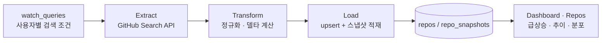
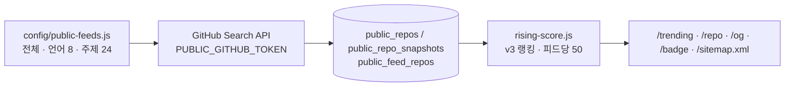
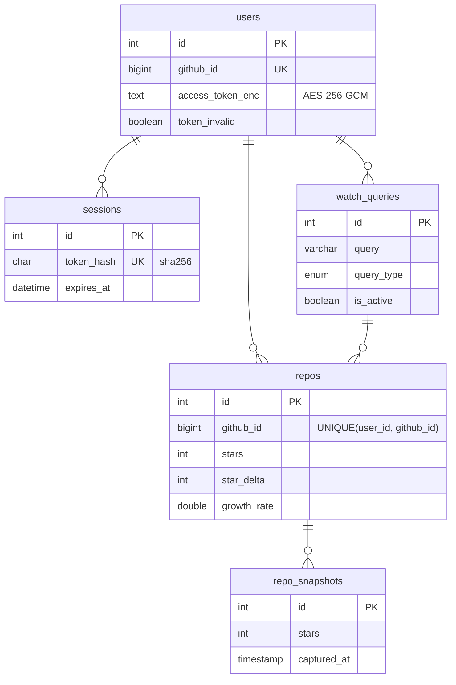

# Trendar

> **지금 뜨는 GitHub 레포를 남들보다 먼저.** — 관심 키워드의 오픈소스를 추적해 *스타 증가율(추세)* 로 급상승 레포를 골라주는 GitHub 트렌드 레이더.

**라이브 데모 → https://trendar.org** (GitHub 계정으로 로그인, 가입 불필요) · **로그인 없이 보기 → https://trendar.org/trending**

---

## 왜 만들었나

GitHub Search API는 **"현재 스타 몇 개"** 만 알려주지, **"지금 뜨고 있는지"** 는 알려주지 않는다.
그래서 정작 궁금한 *"요즘 빠르게 성장하는 레포"* 를 찾을 수가 없다.

Trendar는 관심 키워드에 매칭되는 레포의 스타 수를 **6시간마다 스냅샷으로 기록**하고,
이전 스냅샷과 비교해 **증가율(델타)** 을 계산함으로써 *"지금 뜨는 레포"* 를 보여준다.

> 비유하면 체중계 앱과 같다 — 매번 몸무게를 재서(스냅샷) 어제보다 얼마 빠졌나(델타)를 보여주듯, "레포의 스타"를 계속 재는 것.

---

## 핵심 기능

- **트렌드 추적** — 현재 스타가 아니라 *스타 증가율* 로 급상승 레포를 포착
- **신생 트렌드 발견** — 스타순 수집과 별도로 최근 90일·7일 내 생성 레포 슬라이스를 병행 수집하고, 생성 15일 이내 레포를 공개 피드와 같은 `rising-score-v3` 규칙(하루 환산 증가·증가율·가속도)로 '신생 급상승'에 노출 — 역대 스타 상위에 가려진 진짜 뜨는 신규 프로젝트를 잡는다
- **목적형 수집** — 전체를 긁는 크롤러가 아니라, 사용자가 등록한 검색 조건(watch query)에 매칭되는 레포만 선별 수집
- **시계열 스냅샷** — 시점별 지표를 쌓아 레포별 성장 추이를 차트로 제공
- **생태계 분포** — 관심 영역이 어떤 언어·조건으로 분포하는지 집계
- **큐레이션** — 관심 레포를 북마크·메모로 추적
- **멀티테넌트** — GitHub 로그인 기반. 검색어·레포·북마크가 **사용자별로 완전 격리**되고, 수집도 **각자의 OAuth 토큰**으로 실행되어 레이트리밋을 분산
- **남용 방지** — 수동 수집에 사용자별 **일일 한도**(기본 10회, KST 자정 리셋), 조건 개수 상한
- **공개 트렌드** — 로그인 없이 볼 수 있는 서버 렌더 페이지(`/trending`, 언어·주제별 피드, 레포 페이지, 한국어 `/ko`). 서버 전용 토큰으로 모은 공개 풀을 하루 환산 증가 속도로 랭킹하고, 링크 미리보기 PNG·README 배지·동적 sitemap을 제공 ([공개 트렌드](#공개-트렌드) 참고)
- **악성 저장소 제외** — 수집 때 README를 읽어, 원격 스크립트 즉시 실행 지시와 백신·실시간 보호 끄기 안내가 **함께** 있는 저장소를 대시보드 급상승·성장률 상위와 공개 트렌드에서 숨긴다 ([악성 저장소 제외](#악성-저장소-제외) 참고)
- **급상승 알림 웹훅** — 수집이 끝날 때 대시보드 신생 급상승(상위 8개)에 새로 들어온 저장소를, 사용자가 등록한 URL로 서명해 보낸다. Discord·Slack 수신 주소는 그 서비스가 읽는 형식으로 보낸다 ([급상승 알림 웹훅](#급상승-알림-웹훅) 참고)

---

## 어떻게 동작하나

크론이 6시간마다 유효한 토큰을 가진 사용자를 순회하며, **각자의 검색 조건 · 각자의 토큰**으로 수집한다. 조건마다 **세 슬라이스**를 검색한다 — 스타순 베이스라인(`stars:>=1000`), 신생 슬라이스(`created:>90일전`, 하한 50), 초신생 슬라이스(`created:>7일전`, 하한 20, `ETL_FRESH_*`) — 같은 레포가 여러 슬라이스에 걸려도 실행 단위 dedup으로 스냅샷은 1행만 쌓인다. 검색은 스타순 상위 100개만 돌려주므로, 90일 슬라이스는 인기 키워드에서 커트라인이 수천 스타까지 올라간다(2026-10 측정: `AI` 약 4,100). 초신생 슬라이스는 갓 생긴 레포를 수십~수백 스타 단계에서 잡기 위한 것이다.



**순서가 핵심**: 새 스냅샷을 넣기 *전에* 직전 스냅샷을 읽어야 델타가 올바르게 계산된다.
`growth_rate = (이번 스타 − 저번 스타) / max(저번 스타, 1)`, 첫 수집은 비교 대상이 없어 0으로 처리한다.
신생 급상승은 직전 수집 간격 대신 24시간 이전의 가장 가까운 스냅샷을 기준으로 증가량을 계산해 수동 수집 여부와 무관하게 비교한다.

**공개 트렌드 수집**은 같은 크론(`ETL_CRON`)에서 사용자 ETL과 독립적으로 돈다. 사용자 토큰이 아니라 서버 전용 `PUBLIC_GITHUB_TOKEN`으로 피드마다(전체 1 + 언어 + 주제) `is:public created:>{오늘−15일} stars:>=20` 검색을 2.1초 간격으로 실행하고, 결과를 사용자 테이블과 분리된 `public_*` 테이블에 적재한다. 한 피드가 실패해도 나머지는 계속하고, 이전 수집이 진행 중이면 이번 실행은 건너뛴다.



---

## 기술 스택

| 영역 | 사용 기술 |
| --- | --- |
| 언어 / 런타임 | TypeScript · Node.js |
| 프론트엔드 | React 18 · Vite · react-router-dom · Recharts |
| 백엔드 | Express (REST JSON) · node-cron |
| 외부 데이터 | GitHub Search API (`@octokit/rest`) |
| DB | MySQL (`mysql2`) |
| 인증 | GitHub OAuth App · DB 세션 + httpOnly 쿠키 · AES-256-GCM 토큰 암호화 |
| 배포 | 개인 VPS (Docker, Coolify Traefik 뒤 통합 서빙) |
| 테스트 | `node:test` (의존성 주입 기반 단위 테스트) |

---

## 아키텍처

- **백엔드** (`backend/`) — Express REST API + GitHub OAuth 인증 + 사용자별 ETL 파이프라인(크론·수동). 핵심 로직은 의존성 주입(팩토리) 구조라 DB·GitHub 없이 단위 테스트가 가능하다.
- **프론트엔드** (`frontend/`) — React SPA. 인증 컨텍스트, 401 공통 처리, 로딩/에러/빈 상태 3종을 표준화. 프로덕션에선 백엔드가 정적 빌드를 같은 오리진으로 통합 서빙한다.
- **인증 · 격리** — GitHub OAuth(스코프 없음, 공개 데이터만)로 로그인하며, 발급된 토큰은 암호화 저장 후 수집에 재사용된다. 세션은 JWT 대신 DB 세션 + httpOnly 쿠키로 로그아웃·탈퇴 시 즉시 무효화된다. 모든 데이터 API는 `user_id` 스코프로 격리된다.
- **공개 트렌드** — 같은 Express가 `/api` 뒤·SPA 정적 서빙 앞에서 공개 경로를 서버 렌더한다(`backend/src/public-mount.js`). 공개 풀(`public_*` 테이블)은 사용자 테이블과 FK·조인이 없고 공개 경로는 사용자 데이터를 조회하지 않는다. HTML에는 인라인 스크립트가 없어(JSON-LD는 비실행 블록) CSP를 그대로 둔다.

<details>
<summary><b>데이터 모델 (ERD)</b></summary>



관계는 전부 `ON DELETE CASCADE` — 계정 탈퇴 시 세션·조건·레포·스냅샷이 연쇄 삭제된다.

공개 풀 테이블(`public_feeds`, `public_repos`, `public_repo_snapshots`, `public_feed_repos`, `public_daily_metrics`)은 사용자 테이블과 연결이 없어 탈퇴해도 남는다. 피드 이름·검색어는 DB가 아니라 `backend/src/config/public-feeds.js`가 기준이다.

급상승 알림 웹훅 테이블(`webhook_endpoints`, `webhook_deliveries`, `webhook_notified_repos`)은 `users`에 `ON DELETE CASCADE`로 묶여 있어 탈퇴하면 수신 URL·발신 기록·보냄 기록이 함께 지워진다.
</details>

주요 설계 결정은 ADR로 기록되어 있다 (`.claude/specs/adr/`): 완전 사용자별 격리 · OAuth App 선택 · DB 세션 · 일일 한도 카운터.

---

## 빠른 시작 (로컬)

```bash
# 1) 데이터베이스 (MySQL) — 백엔드가 부팅 시 스키마를 자동 생성한다
mysql -u root -p < db/schema.sql   # (선택) 수동 생성

# 2) 백엔드
cd backend
cp .env.example .env               # DB 접속정보 + GitHub OAuth + TOKEN_ENCRYPTION_KEY 채우기
npm install
npm run dev                        # http://localhost:4000
npm test                           # 단위 테스트
npm run typecheck                  # 타입 검사 (아래 'TypeScript 전환' 참고)

# 3) 프론트엔드
cd frontend
npm install
npm run dev                        # http://localhost:5173 (/api 와 공개 경로는 4000으로 프록시)
```

> 백엔드 없이 UI만 보려면 `frontend/.env.local` 에 `VITE_USE_MOCK=true` 를 두면 인메모리 목 데이터로 동작한다.

### TypeScript 전환 (진행 중)

백엔드는 런타임을 바꾸지 않고 파일 단위로 점진 전환한다.

1. **(완료) 타입 검사 켜기** — `backend/tsconfig.json`은 `allowJs` + `checkJs: false`라, 맨 위에 `// @ts-check`가 있는 JS 파일만 검사한다. 빌드 산출물은 없다. 현재 대상: `services/rising-score.js`, `services/rising-response.js`, `utils/limits.js`.
2. **(완료) API 계약 타입 공유** — `shared/api-types.ts`를 프론트(`import type`)와 백엔드(JSDoc `import(...)`)가 함께 쓴다. 현재 `RisingRepo`(/api/rising). 응답 형태를 바꾸면 양쪽 `typecheck`가 동시에 잡는다.
3. **(다음)** `// @ts-check` 대상을 utils → services → models → controllers 순으로 넓히고, 나머지 API 타입(`frontend/src/types.ts`)을 `shared/`로 옮긴다. models는 mysql2 `pool.query` 결과 타입(`QueryResult`) 캐스팅 헬퍼부터 만든다.
4. **(그 다음)** 파일을 `.ts`로 바꾼다. Node 22의 타입 제거 실행을 쓰면 빌드 단계 없이 유지할 수 있다(enum 등 비지원 문법은 `erasableSyntaxOnly`로 막는다). 테스트는 마지막.

### GitHub OAuth App 설정

로그인과 수집 모두 사용자의 GitHub OAuth 토큰을 쓴다. [OAuth App](https://github.com/settings/developers)을 등록하고 `GITHUB_CLIENT_ID` / `GITHUB_CLIENT_SECRET` 을 `.env` 에 넣는다.

- 콜백 URL은 1개만 지원하므로 **dev/prod 앱을 각각 등록** (dev: `http://localhost:5173/api/auth/github/callback`)
- **스코프는 요청하지 않는다** — 공개 레포 검색 + 공개 프로필만 사용. 토큰은 사용자별 레이트리밋 확보 용도이며 암호화 저장된다.
- `TOKEN_ENCRYPTION_KEY`(64자 hex)와 `APP_URL` 은 프로덕션 필수. 키 생성: `node -e "console.log(require('crypto').randomBytes(32).toString('hex'))"`

### 관리자 운영 현황

`/admin`은 소유자 한 계정만 접근하는 **조회 전용** 콘솔이다. 서버의 `ADMIN_GITHUB_ID`에 소유자의 **숫자 GitHub ID 하나**를 지정하고 기존 GitHub 로그인으로 접속하면 계정 메뉴에 **운영 현황**이 표시된다. 로그인명은 변경될 수 있으므로 인가에 사용하지 않는다. ID는 GitHub 공개 API `https://api.github.com/users/<login>`의 `id`로 확인한다.

- **기본값은 모두 거부**: 설정이 없거나 양의 십진 ID가 아니면 관리자 API는 403이다. `.env.example`은 빈 값을 유지한다. 실제 환경 ID 설정·권한 부여와 배포는 별도 승인 후 수행한다.
- **운영 요약**: 전체 회원, 저장 Free/Pro 플랜, 구독 상태별 인원, 마지막 수집 실패, 공개 저장 레포 수. 저장 플랜은 표시용 캐시이며 실제 구독 권한·매출과 같지 않다.
- **회원 목록**: GitHub 로그인명 부분 검색, 페이지당 25명, 가입 일시·구독 기간 종료·검색 조건/레포 수·마지막 수집 결과·토큰 무효 여부. 미수집은 성공과 구별하며 모든 시각은 KST다.
- **공개 피드**: 현재 설정된 전체·언어·주제 피드의 최근 시도/성공, 성공·실패·미수집, 안전한 오류 코드, 누적 연결 레포 수. 연결 수는 전체 저장된 membership 기준이고 공개 페이지의 현재 노출 수와 다르다.
- **데이터 변경 없음**: 새로고침·재시도는 조회만 다시 한다. 회원 삭제·정지·한도/구독 변경·재수집은 제공하지 않는다. 암호화 토큰·세션값·결제 식별자·수집 오류 원문은 응답하지 않는다. UI 목 모드는 관리자 접근을 허용하지 않는다.

| 관리자 API | 조회 내용 |
| --- | --- |
| `GET /api/admin/overview` | 회원·저장 플랜·구독 상태·실패 집계와 조회 시각 |
| `GET /api/admin/users?search=<login>&page=1` | 로그인명 리터럴 부분 검색, 25행 페이지(1~100000), 검색어 최대 100자 |
| `GET /api/admin/feeds` | 설정된 피드와 DB 수집 상태 병합, 미수집 피드 포함 |

모든 관리자 요청은 `Cache-Control: no-store`이며 **인증 → 고정 ID 인가 → 메서드/경로 처리** 순서다. 비로그인/만료 세션은 401, 일반 회원은 403, 인가된 계정의 GET 외 메서드(HEAD 포함)는 405, 미등록 GET 경로는 404다. 스키마 변경은 없다.

---

## 급상승 알림 웹훅

로그인한 사용자가 **계정 메뉴 → 알림 웹훅**(`/account/webhook`)에서 수신 URL을 하나 등록하면, 수집(6시간 크론·수동)이 끝날 때마다 자기 대시보드 **신생 급상승 상위 8개**에 새로 들어온 저장소를 그 URL로 `POST`한다.

- **새 진입 기준**: 같은 저장소는 사용자당 한 번만 알린다. 처음 등록할 때와 꺼 두었다가 다시 켤 때 그 시점의 상위 8개는 이미 보낸 것으로 기록하므로, 등록 직후 알림이 몰리지 않는다. 판정은 수집이 끝나는 시점에만 하므로 두 수집 사이에 잠깐 들어왔다 빠진 저장소는 알리지 않는다. 악성 판정 저장소는 급상승에서 빠지므로 알림에도 없다.
- **수신 URL**: `https://` 주소만 받는다. 루프백·사설·링크로컬 등 내부 주소로 풀리는 호스트는 거부하고, 발신할 때마다 다시 확인한 주소로만 연결한다(리다이렉트는 따라가지 않는다). URL과 서명 키는 암호화해 저장하고 화면에는 호스트와 끝 4자만 보인다.
- **서명 키**: 등록·재발급 직후 화면에 한 번만 표시된다. 잃어버리면 재발급한다.
- **Discord·Slack**: `discord.com/api/webhooks/…`는 `{ "content": … }`, `hooks.slack.com/…`은 `{ "text": … }` 본문으로 저장소 이름·스타·하루 증가·링크를 보낸다.

### 본문과 헤더

```http
POST /your/hook HTTP/1.1
Content-Type: application/json
User-Agent: Trendar-Webhook/1
X-Trendar-Event: rising.new
X-Trendar-Delivery: 3f1c9c0e-6c1b-4f5e-9d0a-2b7f0f6f3a11
X-Trendar-Signature: t=1794268800,v1=<hex>
```

```json
{
  "id": "3f1c9c0e-6c1b-4f5e-9d0a-2b7f0f6f3a11",
  "event": "rising.new",
  "created_at": "2026-11-10T06:00:12.000Z",
  "data": {
    "repos": [
      {
        "github_id": 123456789, "full_name": "owner/name", "html_url": "https://github.com/owner/name",
        "description": "…", "language": "Go", "stars": 1840,
        "rate_24h": 612.5, "growth_rate_24h": 0.5, "age_days": 3.2, "rank": 1, "estimated": false
      }
    ]
  }
}
```

`rate_24h`는 하루 환산 스타 증가, `rank`는 알림 시점의 급상승 순위, `estimated`는 24시간 전 기록이 없어 짧은 구간을 하루로 환산한 값이라는 뜻이다. 화면의 **테스트 발신**은 `event: "ping"`, `data: {}`를 보낸다.

### 서명 검증

`X-Trendar-Signature`의 `v1`은 `HMAC-SHA256(서명 키, "<t>.<요청 본문 그대로>")`의 hex다. 본문을 JSON으로 다시 직렬화하지 말고 받은 바이트 그대로 검증한다. `t`(유닉스 초)가 너무 오래된 요청은 버린다.

```js
import { createHmac, timingSafeEqual } from 'node:crypto';

export function verifyTrendarSignature(rawBody, header, secret, toleranceSeconds = 300) {
  const match = /^t=(\d+),v1=([0-9a-f]{64})$/.exec(header ?? '');
  if (!match) return false;
  const [, timestamp, signature] = match;
  if (Math.abs(Date.now() / 1000 - Number(timestamp)) > toleranceSeconds) return false;
  const expected = createHmac('sha256', secret).update(`${timestamp}.${rawBody}`).digest();
  return timingSafeEqual(expected, Buffer.from(signature, 'hex'));
}
```

### 재시도와 자동 꺼짐

- `2xx` 응답이면 성공이다. 그 밖의 상태·리다이렉트·5초 초과·연결 실패는 **1분 → 5분 → 30분 → 2시간** 뒤 다시 보내 총 5회까지 시도한다. 대기 중인 발신은 DB에 있어 서버가 재시작해도 이어진다.
- 재시도는 같은 `X-Trendar-Delivery`와 같은 본문으로 간다. 드물게 같은 발신이 두 번 도착할 수 있으므로 받는 쪽은 이 값으로 중복을 거른다.
- 알림 3건이 연속으로 끝내 실패하면 수신 URL을 자동으로 끄고 화면에 표시한다. 다시 켜면 그때부터 새 진입만 보낸다. 테스트 발신 실패는 세지 않는다.
- 5회 모두 실패했거나 꺼서 취소된 알림에 들어 있던 저장소는 다시 보내지 않는다. 발신 기록은 최근 10건을 화면에 보여 주고 30일 뒤 지운다.

| API (로그인 세션 필요) | 내용 |
| --- | --- |
| `GET /api/webhook` | 가린 URL·형식·사용 여부·자동 꺼짐, 최근 발신 10건 |
| `PUT /api/webhook` `{ url }` | 등록(201, 서명 키 1회 반환) 또는 URL 변경(200) |
| `PATCH /api/webhook` `{ enabled }` | 켜기·끄기 (끄면 대기 중인 발신 취소) |
| `POST /api/webhook/secret` | 서명 키 재발급 |
| `POST /api/webhook/test` | `ping` 1회 발신과 결과 (사용자당 10초에 1회) |
| `DELETE /api/webhook` | 수신 URL·발신 기록·보냄 기록 삭제 |

로컬에서 `http://localhost` 수신 서버로 시험하려면 백엔드 환경변수 `WEBHOOK_ALLOW_PRIVATE_TARGETS=true`를 둔다. 운영(`NODE_ENV=production`)에서는 이 값과 무관하게 내부 주소와 `http`를 받지 않는다.

---

## 공개 트렌드

로그인하지 않은 방문자·검색엔진·링크 미리보기를 위한 서버 렌더 페이지다. 기존 로그인 기능(대시보드·조건·레포)은 그대로이고, 로그인 사용자 헤더에는 `트렌드` 링크가 추가된다.

### 공개 경로

| 경로 | 내용 | 캐시 |
| --- | --- | --- |
| `/` | 비로그인: 전체 피드 상위 레포 랜딩(SSR) · 로그인: 기존 대시보드(SPA) | `private, no-store` + `Vary: Cookie` |
| `/trending` | 전체 피드 — 순위·이름·설명·언어·총 스타·하루 증가·생성 경과일·갱신 시각 | `public, max-age=600` |
| `/trending/language/<slug>` · `/trending/topic/<slug>` | 언어·주제 피드 (최대 50개) | `public, max-age=600` |
| `/repo/<owner>/<name>` | 최근 30일 스타 추이·소속 피드·GitHub 링크·배지 삽입 코드 | `public, max-age=600` |
| `/ko`, `/ko/trending…`, `/ko/repo/…` | 위 페이지의 한국어판 | `public, max-age=600` |
| `/og/trending.png`, `/og/trending/language/<slug>.png`, `/og/trending/topic/<slug>.png`, `/og/repo/<owner>/<name>.png` | 1200×630 링크 미리보기 PNG | `public, max-age=600` |
| `/badge/<owner>/<name>.svg` | README 배지 (항상 200) | `public, max-age=3600` |
| `/sitemap.xml` | `/`, `/ko`, 모든 피드, 피드 상위 50위 레포 페이지 — en/ko 각각, `lastmod` = 마지막 수집 성공 시각 | `public, max-age=600` |

알 수 없는 slug나 공개 풀에 없는 레포는 404 HTML(noindex, 피드 목록 링크)을 준다. 모든 페이지에 canonical·hreflang(en·ko·x-default)·Open Graph·Twitter·JSON-LD와 "내 키워드 추적하기" GitHub 로그인 CTA가 들어간다. 로컬 dev에서는 Vite가 `/trending`, `/repo`, `/og`, `/badge`, `/ko`, `/sitemap.xml`을 4000으로 프록시하고 `/`는 SPA로 남는다 — 비로그인 SSR 랜딩은 `http://localhost:4000/`에서 확인한다.

### PAT 설정과 첫 수집

1. GitHub → Settings → Developer settings → [Fine-grained tokens](https://github.com/settings/personal-access-tokens)에서 토큰을 만든다. **Repository access: Public repositories (read-only)**, 추가 권한 없음. 만료일을 정하고 갱신 일정을 기록해 둔다.
2. `backend/.env`에 `PUBLIC_GITHUB_TOKEN=<토큰>`을 넣는다. 토큰은 서버 전용이며 로그·DB·응답에 남기지 않는다. 비워 두면 서버는 경고 1줄을 남기고 정상 기동하며 공개 수집만 건너뛴다.
3. 크론을 기다리지 않고 첫 수집을 바로 돌린다.

```bash
cd backend
node src/etl/public-pipeline.js    # 피드 33개 기준 Search 33회 × 2.1초 ≈ 70초, 끝나면 결과 요약 출력
```

이후에는 `ETL_CRON`(기본 6시간) 주기로 자동 수집된다. 토큰이 만료되거나 폐기되면(401) 그 실행은 중단되고 피드 상태가 `error`로 기록된다(`public_feeds.last_status`, `last_error_code`). 페이지에는 마지막 성공 시각이 표시된다.

### 피드 카탈로그

공통 검색 조건은 `is:public created:>{오늘−15일} stars:>=20`이고, 피드마다 아래 조건을 덧붙인다. 목록은 `backend/src/config/public-feeds.js`에 slug · 표시 이름(en/ko) · 검색어로 정의되어 있다.

- **전체** — `/trending` (추가 조건 없음)
- **언어 8** — `python`, `typescript`, `javascript`, `go`, `rust`, `java`, `cpp`(C++), `csharp`(C#) → `language:<x>`
- **주제 24** — `llm`, `ai-agents`, `rag`, `mcp`, `generative-ai`, `machine-learning`, `deep-learning`, `computer-vision`, `nlp`, `react`, `nextjs`, `vue`, `developer-tools`, `cli`, `automation`, `devops`, `kubernetes`, `docker`, `observability`, `self-hosted`, `security`, `database`, `data-engineering`, `game-development` → `topic:<x>`

`PUBLIC_LANGUAGES` · `PUBLIC_TOPICS`에 slug를 쉼표로 적으면 그 피드만 수집·노출한다(예: `PUBLIC_TOPICS=llm,rag,mcp`). 비우면 카탈로그 전체, 모르는 slug는 기동 오류다. 실행당 Search 호출은 `1 + 언어 수 + 주제 수`이며, `ETL_SEARCH_INTERVAL_MS`(기본 2100) 간격으로 30회/분 한도 아래를 유지한다. 표본이 없는 피드는 빈 상태로 보여 준다.

### 랭킹 — 대시보드 '신생 급상승'과의 차이

공개 피드와 로그인 대시보드의 '신생 급상승'은 모두 `rising-score-v3` 규칙을 구현한 순수 함수(`backend/src/services/rising-score.js`의 `rankRising`)를 쓴다. 공개 피드는 공개 스냅샷에, 대시보드는 사용자 레포 스냅샷(`repo.model.js`의 `risingCandidates` → `rankUserRising`)에 적용한다. 이전에 대시보드가 쓰던 SQL 하드컷(`24시간 증가 ≥ RISING_MIN_DELTA(500)`)은 제거했다.

| | rising-score-v3 |
| --- | --- |
| 기준선 | `[cur−36h, cur−20h]`에서 `cur−24h`에 가장 가까운 스냅샷 → 없고 생성 36시간 이내면 생성 시각·0스타(`creation`) → 없으면 `cur−6h` 이전 가장 이른 스냅샷(`partial`) |
| 증가 값 | `rate_24h = 증가 × 24 / max(구간 시간, 12)` — 하루 환산 |
| 신선도 | 최신 스냅샷이 13시간보다 오래되면 제외 |
| 노출 | 생성 `RISING_WINDOW_DAYS`(기본 15)일 이내 · `rate_24h ≥ RISING_MIN_RATE`(100) · 그리고 (증가율 ≥ `RISING_MIN_GROWTH`(10%) 또는 `rate_24h ≥ RISING_ABS_PASS`(500) 또는 `creation`) |
| 정렬 | `score = rate_24h / √(생성 경과일 + 1) × √accel` (가속도 `accel`은 0.5~2, 이전 하루와 비교), 동점은 `rate_24h` → `id` |
| 개수 | 대시보드 위젯 8개(`limit` 1~50) · 피드당 최대 50 |

`creation`·`partial` 기준선 값은 실제 구간이 24시간이 아니므로 화면에 `est.`(추정)로 표시한다. 대시보드는 가속도가 1.2 이상이면 ↑, 0.8 이하면 ↓를 붙인다.

`RISING_WINDOW_DAYS`는 대시보드와 공개 수집·노출 창이 함께 쓴다. 공개 피드를 스펙대로 15일 창으로 운영하려면 이 값을 15로 둔다(미설정 시 15).

### 악성 저장소 제외

공개 수집과 사용자 수집은 처리한 저장소의 README를 GitHub API로 읽어 판정하고 `repo_security_verdicts`(github_id 기준, 대시보드·공개 풀 공유)에 남긴다. README 텍스트와 검색 응답에 이미 있는 메타(language·forks·size)만 쓰며 링크·첨부·코드는 내려받거나 실행하지 않는다. 현재 규칙은 2판(`rule_version = 2`)이다.

- **malicious** — README에 아래 두 신호가 **둘 다** 있을 때만. 2026-11 공개 피드에 올라온 가짜 크랙·치트 저장소 군집(`windows-defender.cc` 스크립트 실행 + 실시간 보호 중지)이 기준 사례다.
  - **실행 지시**: 원격 스크립트를 받아 바로 실행하는 명령. 파이프(`irm … | iex`, `irm … | &(gcm i*x)`, `curl … | sh`), 저장 후 실행(`curl … > run.ps1 && powershell -File run.ps1`, 같은 코드블록의 다음 3줄 안에서 실행하는 경우 포함), 치환(`bash <(curl …)`, `sh -c "$(curl …)"`, `[scriptblock]::Create((irm …))`), `mshta https://…`, 그리고 `powershell -enc <base64>`를 풀었을 때 본문에 위 형태가 있는 경우.
  - **보호 해제 안내**: Windows Defender·실시간 보호·백신을 끄거나 일시 중지하라는 영어 문구와 명령(`Set-MpPreference -Disable…`, `sc stop WinDefend`, `DisableAntiSpyware` 레지스트리 값 1). 보호 대상을 일반 명사(security software·firewall 등)로만 쓴 명령형 문구는 코드 없는 저장소(language 없음, forks 0, size 100KB 이하)일 때만 인정한다. 영어가 아닌 문구는 부정·금지 표현을 가려낼 수 없어 판정에 쓰지 않는다.
- **clean** — 둘 중 하나만 있거나 둘 다 없음. 정상 설치 안내(`irm https://get.scoop.sh | iex` 등), 백신 예외 등록 안내, SmartScreen 통과 안내, 부정문("끄지 마세요"), 스타 급증, 코드 없는 저장소라는 사실만으로는 숨기지 않는다.
- **unknown** — 처음 검사할 때 README 조회가 실패함. 노출되고 다음 수집에서 다시 검사한다. 이미 판정이 있으면 조회 실패 시 기존 판정을 유지한다.

판정이 없거나 `unknown`이거나 저장소 `pushed_at`·규칙 버전이 바뀐 경우에만 README를 다시 읽는다. `malicious`는 대시보드 신생 급상승·성장률 상위, 공개 랜딩·피드·OG·sitemap·순위 기록에서 빠지고, 레포 페이지·레포 OG는 404, 배지는 중립으로 응답한다. 행·스냅샷은 지우지 않으므로 README가 고쳐져 재검사에서 `clean`이 되면 다음 수집 뒤(공개 페이지는 서버 캐시 최대 10분, 배지는 HTTP 캐시 최대 1시간) 다시 노출된다. 판정 근거는 운영자만 DB에서 본다.

```sql
SELECT github_id, verdict, rule_version, evidence, scanned_at
FROM repo_security_verdicts WHERE verdict = 'malicious' ORDER BY scanned_at DESC;
```

### README 배지

공개 풀에 있는 레포는 배지를 붙일 수 있다. 피드 50위 안이면 `Trending on Trendar · #<순위> <피드명>`, 아니면 하루 증가(`+N/day`)를 보여 주고, 공개 풀에 없는 레포도 깨지지 않도록 중립 배지(`Trendar`)를 200으로 준다. 레포 페이지에 복사용 Markdown이 있다.

```markdown
[](https://trendar.org/repo/<owner>/<name>)
```

### 프록시 신뢰 설정

OG 이미지·배지는 합산해서 IP당 분당 `PUBLIC_IMAGE_RATE_LIMIT_PER_MIN`(기본 120)회로 제한한다. 넘으면 OG는 `429` + `Retry-After`, 배지는 README가 깨지지 않도록 중립 배지를 `no-store`로 준다. 실제 방문자 IP를 얻기 위해 Express `trust proxy`를 `TRUST_PROXY_HOPS`로 설정한다.

- VPS(Traefik 한 단, Cloudflare 프록시 꺼짐, 기본): `TRUST_PROXY_HOPS=1`
- Cloudflare 프록시를 켜면: `TRUST_PROXY_HOPS=2`
- 프록시 없이 직접 노출: `TRUST_PROXY_HOPS=0`

값이 실제 홉 수보다 크면 방문자가 `X-Forwarded-For`를 위조해 제한을 피할 수 있고, 작으면 모든 방문자가 프록시 IP 하나로 묶여 함께 제한된다.

### 캐시

- **페이지**: 응답에 `Cache-Control: public, max-age=600`. 같은 페이지의 DB 조회·랭킹 결과는 서버 메모리에 최대 10분 캐시한다. 비로그인 `/`만 쿠키에 따라 내용이 달라 `private, no-store`.
- **OG PNG**: 데이터 revision(순위·스타·증가·마지막 수집 시각)이 바뀔 때까지 메모리에 캐시한다. 레포 이미지는 현재 피드 순위가 있는 레포만 그리고, 새 렌더는 프로세스 전체에서 초당 1개(순간 최대 5개)로 제한한다. 순위 밖·예산 초과·렌더 실패 시에는 공통 Trendar 이미지(약 30KB)를 캐시 없이 준다.
- **배지**: `public, max-age=3600`.
- 다른 사용자의 쿠키가 있어도 공개 페이지(`/` 제외) 내용은 같고 `Set-Cookie`가 없어 공유 캐시에 안전하다.

### 집계 정의

공개 페이지 방문과 CTA 전환은 `public_daily_metrics`에 일별로 쌓는다. IP 원문·쿠키·UA 원문은 저장하지 않는다.

- **일 단위**: KST 기준 날짜(`day`).
- **page_view**: 공개 페이지 HTML 렌더 1회(`/`의 로그인 사용자 SPA 통과, OG·배지·sitemap은 제외). 키는 경로 템플릿(`landing`, `trending`, `trending-language`, `trending-topic`, `repo`, `not-found`) · 언어 · referrer 도메인(호스트명, `www.` 제거, 없으면 빈 값) · 봇 여부. 서버 메모리에서 합산해 `PUBLIC_ANALYTICS_FLUSH_MS`(기본 60초)마다 DB에 더하므로 재시작 시 최대 한 주기분이 빠질 수 있다.
- **봇 여부**: User-Agent 휴리스틱 — 빈 UA, 또는 `bot`·`crawl`·`spider`·`slurp`·주요 링크 미리보기(facebookexternalhit, Twitterbot, Discordbot, Slackbot 등)·`curl`·`wget`·`python-requests` 등이 들어 있으면 봇. UA를 속이는 크롤러는 사람으로 집계된다.
- **signup**: 공개 페이지 CTA(`/api/auth/github?from=<템플릿>&locale=<언어>`)로 들어와 GitHub **로그인이 완료된** 횟수. 진입 템플릿은 10분짜리 `entry_route` 쿠키로 콜백까지 전달되며, 신규 가입과 기존 사용자 재로그인을 구분하지 않는다.

```sql
SELECT day, path_template, locale, SUM(event_count) AS views
FROM public_daily_metrics
WHERE event_kind = 'page_view' AND is_bot = 0
GROUP BY day, path_template, locale
ORDER BY day DESC;
```

### 스모크 테스트 (`npm run smoke:public`)

실제 MySQL에서 스키마 생성·탈퇴 격리·공개 경로 응답·레이트리밋·집계·성능(`/trending` 캐시 미스 p95 < 300ms)을 한 번에 확인한다. 전용 DB 이름(`trendar_public_smoke*`)이 아니거나 `MYSQL_URL`/`DATABASE_URL`이 설정돼 있으면 데이터를 건드리지 않고 exit 2로 끝난다. `npm test`에는 포함되지 않는다.

```bash
docker run -d --rm --name trendar-public-smoke -e MYSQL_ROOT_PASSWORD=pw \
  -e MYSQL_DATABASE=trendar_public_smoke -p 33062:3306 mysql:8
# MySQL 기동까지 수십 초 대기
cd backend
DB_HOST=127.0.0.1 DB_PORT=33062 DB_USER=root DB_PASSWORD=pw \
  DB_NAME=trendar_public_smoke APP_URL=http://localhost:4000 npm run smoke:public
# 성공: exit 0, 출력에 p95=<ms> samples=50
docker stop trendar-public-smoke
```

### Search Console (운영자 수동 작업)

자동으로 할 수 없는 일이라 배포 후 직접 한다.

1. [Google Search Console](https://search.google.com/search-console)에 `trendar.org` 도메인 속성을 추가하고 DNS TXT 레코드로 소유권을 확인한다.
2. Sitemaps 메뉴에 `https://trendar.org/sitemap.xml`을 제출한다(`robots.txt`에도 같은 경로가 있다).
3. URL 검사로 `/trending`, `/ko/trending`의 색인 생성을 요청하고, 렌더된 HTML에 레포 목록이 보이는지 확인한다.
4. 배포 8주 뒤 노출 수와 공개 페이지 → 로그인 전환(`signup`)을 확인한다. 둘 중 하나라도 0이면 채널 전략을 재검토한다.

---

## 프로젝트 구조

```
trendar/
├── db/          # schema.sql (MySQL) · schema.dbml (dbdiagram.io)
├── shared/      # api-types.ts — 백엔드·프론트 공용 API 계약 타입 (타입 전용)
├── backend/     # Express REST API · GitHub OAuth · ETL 파이프라인 · 공개 트렌드 SSR · node:test
│   ├── src/     # routes · controllers · models · middleware · services · etl · utils · views(공개 HTML) · config/public-feeds.js
│   ├── scripts/ # public-smoke.mjs (npm run smoke:public)
│   └── assets/fonts/  # OG 이미지용 IBM Plex 폰트 (OFL)
└── frontend/    # React + Vite + TypeScript SPA (로그인 + 4 화면)
    ├── src/     # pages · components · api · auth · lib · styles
    └── public/  # robots.txt · llms.txt · og-v2.png (sitemap.xml은 백엔드가 동적 생성)
```

---

## 라이선스

개인 학습·포트폴리오 프로젝트.
